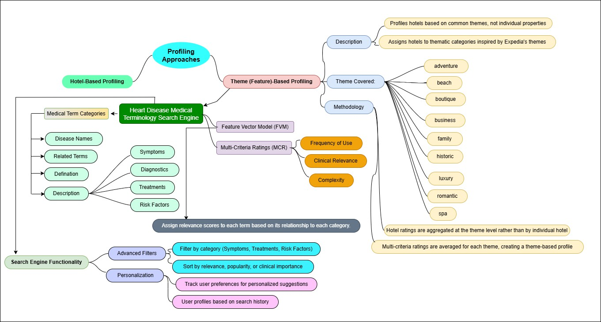
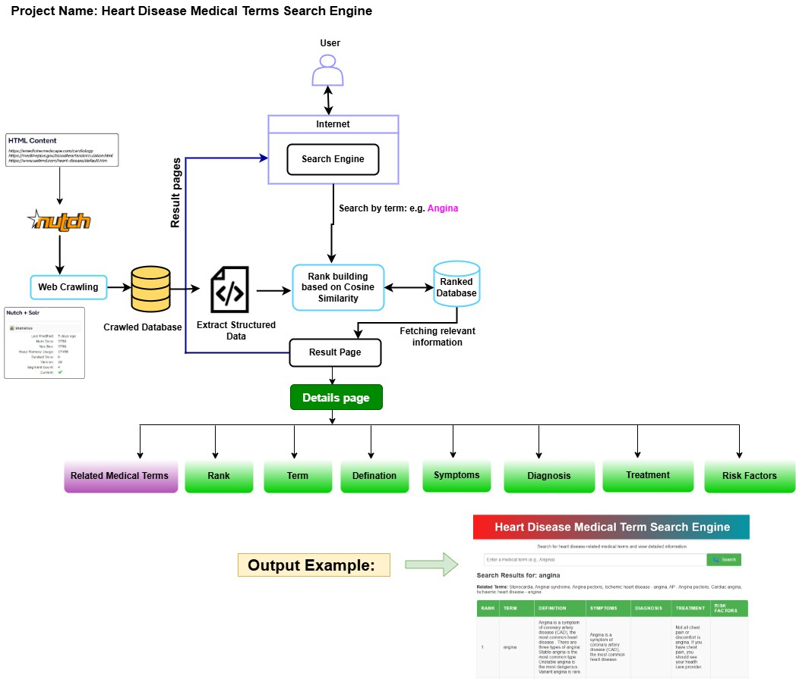
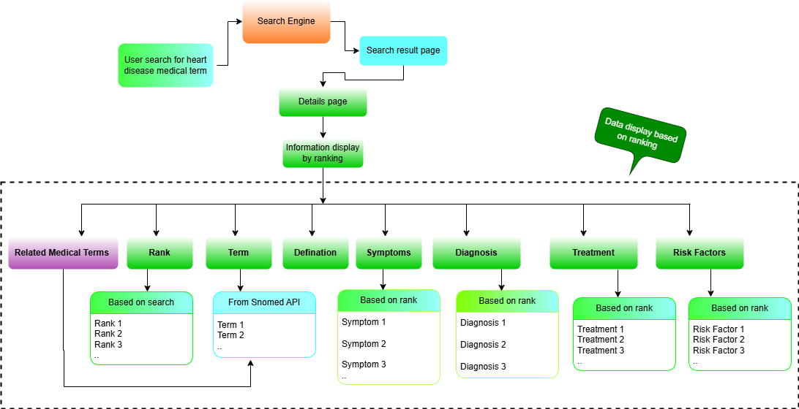
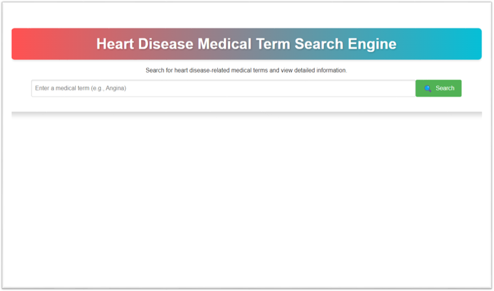
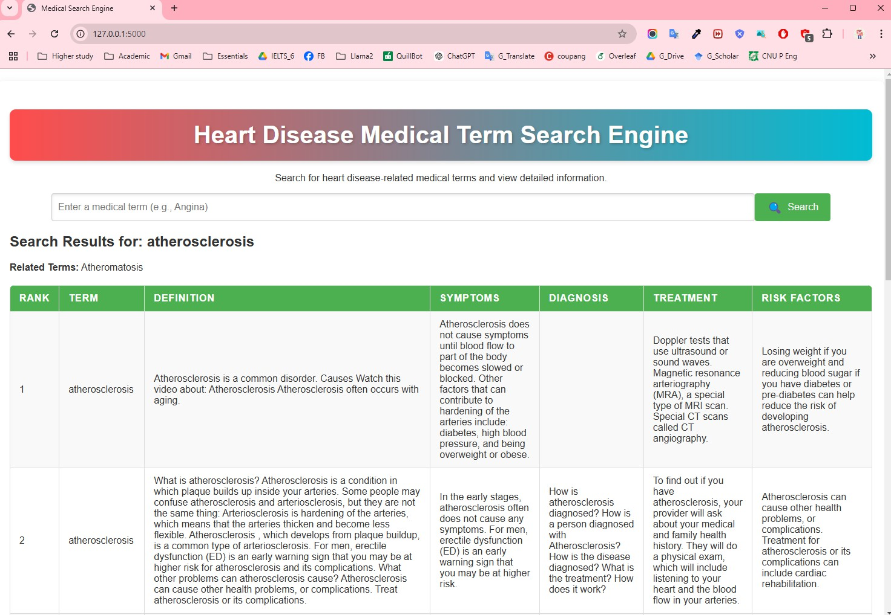
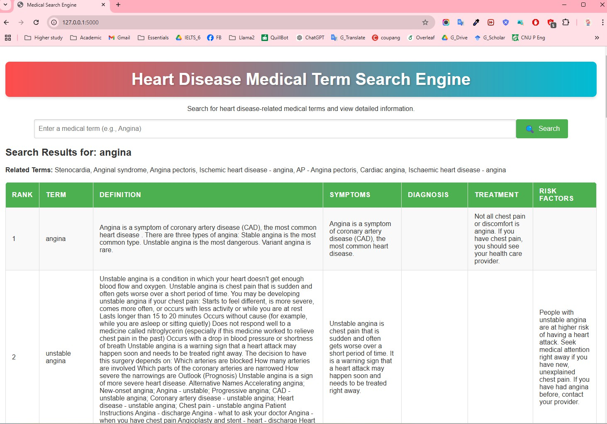
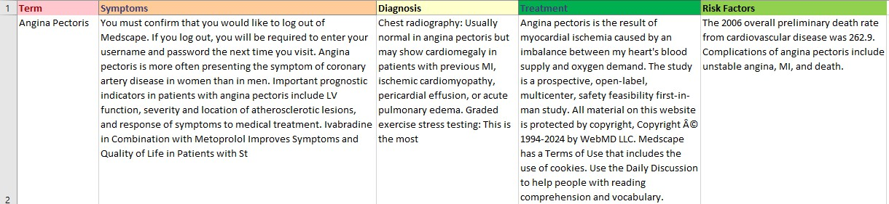

# Heart Diseases Medical Terminology Search Engine

An academic web application for searching heart-disease medical terms and viewing related terminology and structured medical information in one place. The project combines web crawling, biomedical natural language processing (NLP), terminology lookup, text similarity, and a Flask-based web interface.

> **Project scope:** This is an academic information-retrieval prototype. It is intended to support learning and access to medical terminology. It is not a medical diagnosis system and must not replace advice from a qualified healthcare professional.

## Project objectives

- **Collect medical information:** Use Apache Nutch to crawl pages from a configured list of medical websites.
- **Organise information around a medical term:** Present a term with related terms, a definition, symptoms, diagnosis, treatment, and risk factors where available in the collected content.
- **Expand terminology:** Use the SNOMED CT API to retrieve related medical concepts and terms.
- **Extract useful information from text:** Apply biomedical NLP and question-answering/summarisation models to identify disease terms and organise relevant passages.
- **Improve search relevance:** Rank candidate information using TF-IDF representations and cosine similarity.
- **Provide a simple interface:** Make the collected information accessible through a Flask web application.

## Main features

| Feature | What it does |
|---|---|
| Web crawling | Apache Nutch collects pages from URLs configured as crawler seeds. |
| Related-term lookup | The SNOMED CT API is used to retrieve related medical terminology. |
| Disease-term extraction | spaCy's `en_ner_bc5cdr_md` biomedical model identifies disease entities from page titles. |
| Definition extraction | Sentence segmentation with `en_core_sci_sm` and the `deepset/roberta-base-squad2` question-answering model are used to identify definition-like sentences. |
| Medical information extraction | Relevant text is organised into Symptoms, Diagnosis, Treatment, and Risk Factors. |
| Text summarisation | Hugging Face Transformers with `facebook/bart-large-cnn` summarises selected text chunks. The presentation describes chunking to fit the model's 1,024-token input limit. |
| Similarity-based ranking | scikit-learn's `TfidfVectorizer` and `cosine_similarity` rank text based on similarity. |
| Web interface | Flask serves the search page and displays the returned results. |



*Figure 1. Feature profile used to organise the medical information fields and their relationships.*

## System workflow

1. **Configure seed URLs.** A seed file provides the starting URLs for Apache Nutch.
2. **Crawl medical webpages.** Apache Nutch collects page content and stores the crawled data.
3. **Expand medical terminology.** The SNOMED CT API retrieves related terms for a searched concept (for example, *Angina*).
4. **Extract disease terms.** spaCy's biomedical NER model identifies disease entities from page titles.
5. **Extract definitions and key information.** Sentence segmentation and question answering are used to identify definition-like content. Relevant passages are grouped into symptoms, diagnosis, treatment, and risk factors.
6. **Summarise and structure the content.** Text is cleaned, split into manageable chunks, and summarised. The extracted information is stored in structured files for later use.
7. **Match and rank results.** TF-IDF vectors and cosine similarity are used to rank candidate content against the search term or query.
8. **Display results.** The Flask application presents the search results and available medical information in a table-based interface.



*Figure 2. Updated project architecture, adapted from the project presentation.*

## Technologies and tools

| Area | Tools / models |
|---|---|
| Programming language | Python |
| Web framework | Flask |
| Web crawler | Apache Nutch |
| Biomedical NLP | spaCy: `en_ner_bc5cdr_md`, `en_core_sci_sm` |
| Question answering | Hugging Face Transformers: `deepset/roberta-base-squad2` |
| Summarisation | Hugging Face Transformers: `facebook/bart-large-cnn` |
| Text processing and ranking | scikit-learn: `TfidfVectorizer`, `cosine_similarity` |
| Terminology service | SNOMED CT API |
| Data handling | JSON, CSV, and Pandas |
| Front end | HTML and CSS, served through Flask templates and static assets |
| Development / experimentation | Jupyter Notebook |

## Screenshots and sample outputs

### User scenario and application interface



*Figure 3. User-case workflow showing how a search term is processed and how information is organised.*



*Figure 4. Search page of the Heart Diseases Medical Terminology Search Engine.*

### Example search results

The following examples are taken from the project presentation. They illustrate the type of structured information shown by the prototype.



*Figure 5. Example search results for **Atherosclerosis**.*



*Figure 6. Example search results for **Angina**.*

### Extracted medical information



*Figure 7. Example of extracted and summarised medical information, organised by category.*

## Repository structure

```text
Medical-Terminology-Search-Engine/
├── app.py                          # Flask application entry point
├── requirements.txt                # Python dependencies (if present in the repository)
├── extracted_database.json         # Data extracted from crawled webpages
├── pre_database.json               # Preprocessed data
├── extracting_data.ipynb            # Data extraction notebook
├── preprocess_data.ipynb            # Data preprocessing notebook
├── main_process.ipynb               # Main processing notebook
├── snomed_api/
│   ├── get_snomed_term.ipynb        # SNOMED terminology exploration
│   └── snomed_api.py                # SNOMED API integration
├── templates/                       # Flask HTML templates
├── static/                          # CSS and other static assets
├── images/                          # Application images
├── Mind Map/                        # Project mind maps and feature-profiling material
├── Output Example Screenshot/       # Additional output screenshots
└── figures/                         # Figures used in this README
```

The repository may contain additional presentation, demonstration, and project documentation files.

## Setup and installation

### 1. Clone the repository

```bash
git clone https://github.com/monircse061/Medical-Terminology-Search-Engine.git
cd Medical-Terminology-Search-Engine
```

Alternatively, download the repository as a ZIP file from GitHub and extract it.

### 2. Create and activate a virtual environment (recommended)

**Windows PowerShell**

```powershell
python -m venv .venv
.\.venv\Scripts\Activate.ps1
```

**macOS / Linux**

```bash
python -m venv .venv
source .venv/bin/activate
```

### 3. Install dependencies

If `requirements.txt` is available in the repository, run:

```bash
python -m pip install --upgrade pip
pip install -r requirements.txt
```

The project presentation identifies Python packages and models including Flask, Pandas, scikit-learn, spaCy, and Hugging Face Transformers. The notebooks also use the biomedical spaCy models and the Hugging Face models listed above. Install or download any model that is not already available in your environment, following the official instructions for that model.

### 4. Run the Flask application

From the project root, run:

```bash
python app.py
```

Then open the local address shown in the terminal. The project documentation uses:

```text
http://localhost:5000
```

> **Note:** The web application and the full data-generation pipeline are separate parts of the project. Apache Nutch crawling, SNOMED API access, and notebook-based NLP processing may require their own configuration and execution. Check the crawler configuration, seed URL file, notebooks, and `snomed_api/` scripts before attempting to regenerate the data from scratch.

## Data and processing notes

- Crawled webpage content is processed into structured records and stored in JSON/CSV files.
- The project presentation shows medical information organised under **Related Medical Terms, Definition, Symptoms, Diagnosis, Treatment, and Risk Factors**.
- The presentation demonstrates example comparisons for Atherosclerosis and Angina with information pages from the NHS, the US National Heart, Lung, and Blood Institute (NHLBI), and Wikipedia. These comparisons are illustrative; they do not constitute a clinical validation study.
- The quality and completeness of the displayed information depend on the crawled source content, preprocessing, terminology API responses, and NLP model outputs.

## Limitations

- This is a prototype developed for an academic project, not a clinically validated medical system.
- Extracted summaries may omit details or contain errors. Important medical information should be checked against authoritative medical sources and a healthcare professional.
- Search coverage depends on the configured crawler seed URLs and the pages that can be accessed and processed.
- API availability, model downloads, and local hardware resources may affect the data-processing workflow.
- The presentation does not specify pinned software versions or a complete deployment configuration. Environment-specific setup may therefore be required.

## Contributors

- **MD MONIR AHAMMOD** — Project Lead
- **VO NGOC HUY THONG** — Team Member

## License

This project is identified as MIT-licensed in the original project description. Include the repository's `LICENSE` file with the MIT License text so that the license terms are available to users.

## Acknowledgements

The project uses Apache Nutch, spaCy, scikit-learn, Hugging Face Transformers, and the SNOMED CT terminology service. Their respective authors and maintainers are acknowledged for making these tools and resources available.
